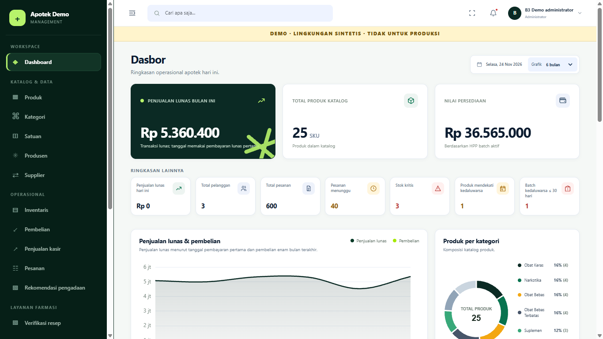
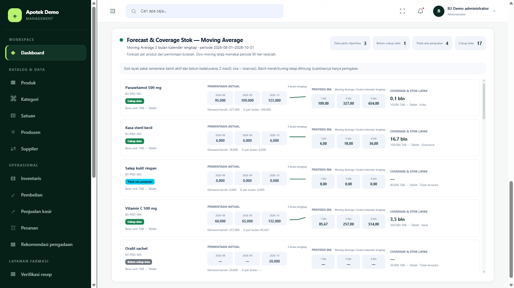
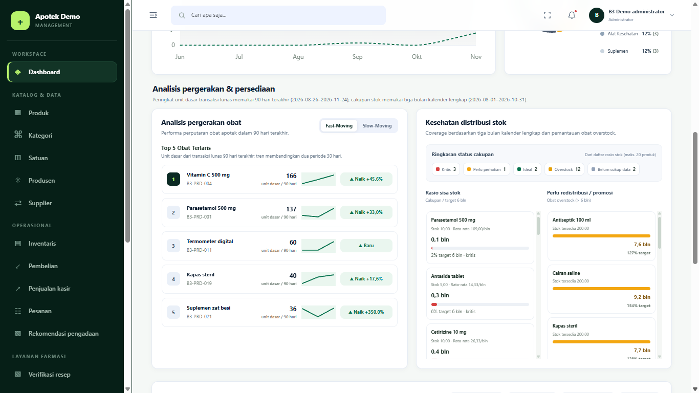
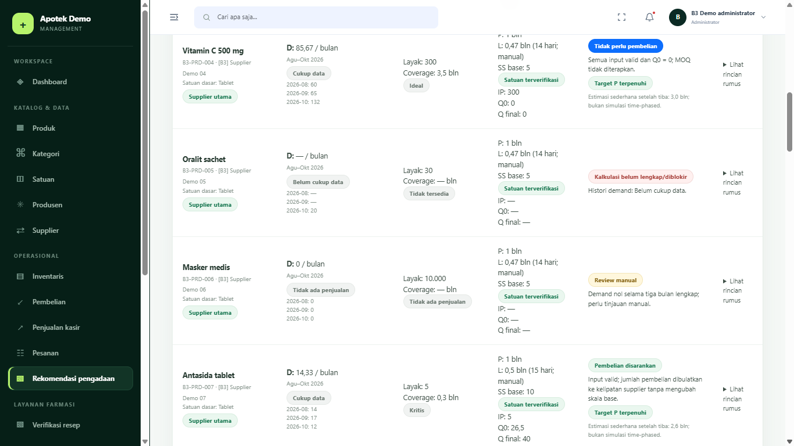
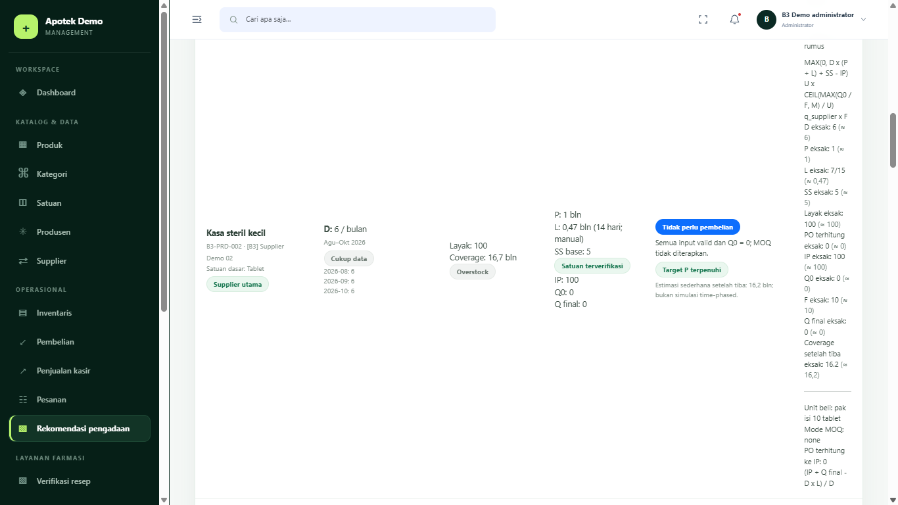
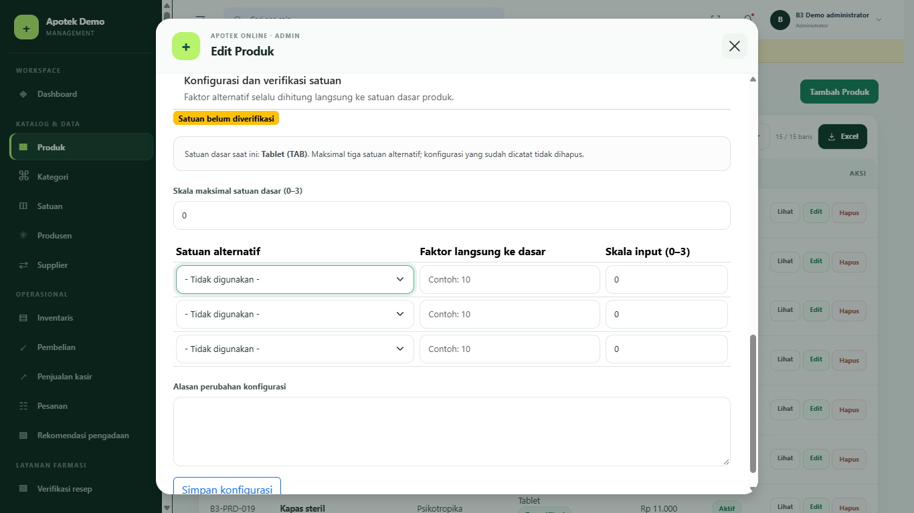

# Apotek Online

Apotek Online adalah aplikasi e-pharmacy berbasis CodeIgniter 3 dan MySQL/MariaDB untuk pengelolaan operasional apotek: katalog produk, satuan, batch/FEFO, pembelian, penjualan kasir, checkout pelanggan, pembayaran, pengiriman, inventaris, dan pelaporan.

## Sorotan Teknis

- CodeIgniter 3, PHP, dan MySQL/MariaDB
- Dashboard administratif dengan navigasi berkelompok
- Penjualan dashboard hanya menghitung pesanan lunas non-batal; bulan ditentukan dari pembayaran lunas pertama.
- Satuan produk, konversi base unit, dan verifikasi satuan
- Forecast Moving Average 3 bulan (bukan AI/ML), coverage stok, dan rekomendasi procurement demo
- Migrasi additive dengan runner/ledger dan checksum
- Seeder demo deterministik serta pemeriksaan invarian
- Gerbang fitur berbasis environment dan marker database demo

## Lingkungan Demo

Fitur demo menggunakan data sintetis, database terpisah, dan marker lingkungan. WAPE hanya dihitung pada riwayat sintetis dan bukan bukti akurasi pada data nyata. Konfigurasi rahasia lokal sengaja diabaikan Git. Repository tidak menyediakan akun demo atau kredensial.

## Tangkapan Layar

Semua gambar berikut berasal dari lingkungan demo dan data sintetis.

## Pengembangan

1. Siapkan PHP 7.4+, MySQL/MariaDB, dan web server lokal.
2. Salin `application/config/config.example.php` ke `application/config/config.php`, `application/config/database.example.php` ke `application/config/database.php`, dan `application/config/demo/database.example.php` ke `application/config/demo/database.php`; jangan commit salinannya.
3. Jalankan migrasi hanya pada scratch atau database demo yang disetujui.
4. Gunakan environment non-produksi untuk fitur demonstrasi.

## Reproducibility dan Batasan

Source, dokumentasi, migrasi, dan tes dapat ditinjau dari repository ini. Setelah dependensi pengembangan tersedia, tes unit yang tidak memerlukan database dapat dijalankan secara lokal. Tes integrasi, karakterisasi HTTP, dan alur demo memerlukan database scratch/demo terpisah, konfigurasi lokal yang tidak disertakan, serta fixture sintetis. Baseline operasional dan akun demo tidak disertakan, jadi hasil database-backed tidak dapat direproduksi hanya dengan clone repository. Fixture demo bersifat deterministik; akurasi forecast belum divalidasi pada data nyata dan WAPE hanya dihitung pada data sintetis. Batasan serta roadmap tersedia di [dokumen desain](docs/design/).

## Struktur

- `application/controllers/`
- `application/libraries/`
- `application/models/`
- `application/views/`
- `application/migrations/`
- `tools/`
- `tests/`
- `docs/`

## Batas Publikasi

Repository ini merupakan snapshot portofolio. Upload, dump, backup, log, vendor, dan konfigurasi rahasia tidak boleh dipublikasikan. Deployment produksi memerlukan peninjauan keamanan terpisah.

## Lisensi

Kode proyek ini dilisensikan di bawah MIT License; lihat [LICENSE](LICENSE).
Direktori `system/` berisi CodeIgniter 3 dengan lisensi MIT tersendiri; lihat [license.txt](license.txt).
