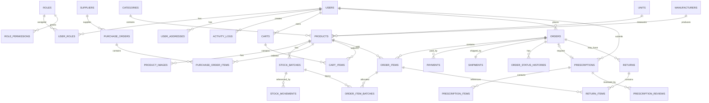

# ERD Database db_apotek_online

## Ringkasan Relasi Utama

## Tabel dan Kelompok

### Identitas dan RBAC
- `roles`, `users`, `user_roles`, `role_permissions`, `activity_logs`, `user_addresses`

### Master Data
- `categories`, `units`, `manufacturers`, `suppliers`, `products`, `product_images`

### Inventaris
- `stock_batches`, `stock_movements`, `stock_opnames`, `stock_opname_items`

### Pengadaan
- `purchase_orders`, `purchase_order_items`

### Pelanggan dan Transaksi
- `carts`, `cart_items`, `orders`, `order_items`, `order_item_batches`
- `payments`, `shipments`, `order_status_histories`

### Resep
- `prescriptions`, `prescription_items`, `prescription_reviews`

### Pengaturan dan Retur
- `store_settings`, `payment_methods`, `shipping_methods`, `promotions`
- `returns`, `return_items`

## Prinsip Integritas

- Nominal menggunakan `DECIMAL(15,2)`.
- Kuantitas menggunakan `DECIMAL(15,3)`.
- Waktu menggunakan `DATETIME`; tanggal menggunakan `DATE`.
- Relasi menggunakan `BIGINT UNSIGNED` dan foreign key InnoDB.
- Stok fisik adalah `stock_batches.remaining_quantity`.
- Stok reservasi adalah `stock_batches.reserved_quantity`.
- Pengurangan stok FEFO dicatat di `order_item_batches` dan `stock_movements`.
- Batch retur tidak otomatis direstok; penambahan hanya saat `restock_allowed = 1` dan dievaluasi.
- Semua proses checkout, pembayaran, penerimaan, reservasi, dan pembatalan wajib menggunakan transaksi database dan `SELECT ... FOR UPDATE`.
