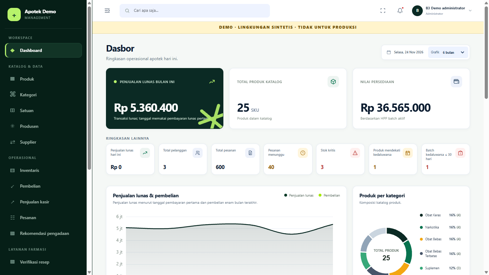
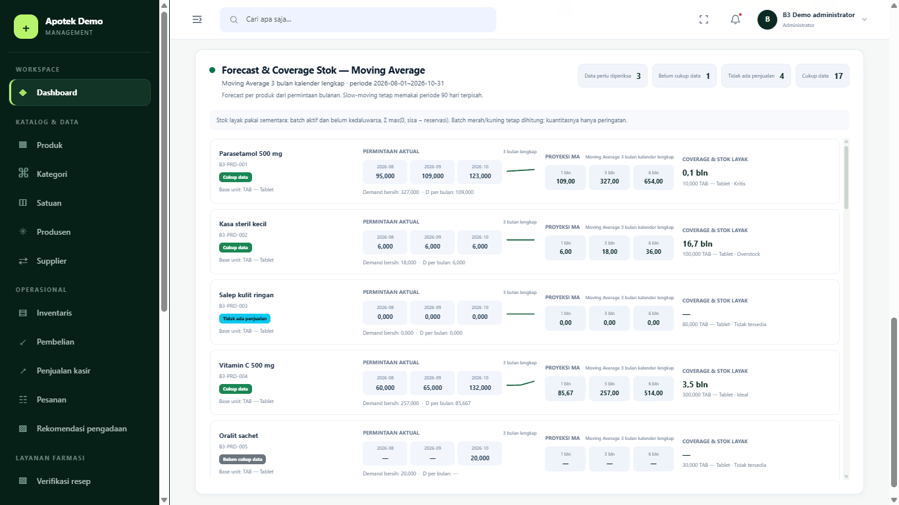
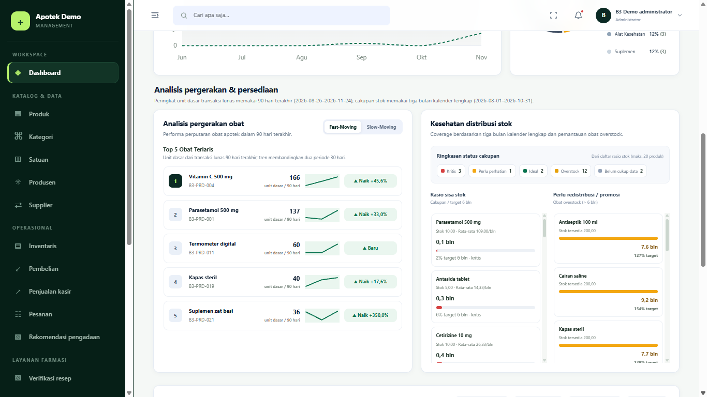
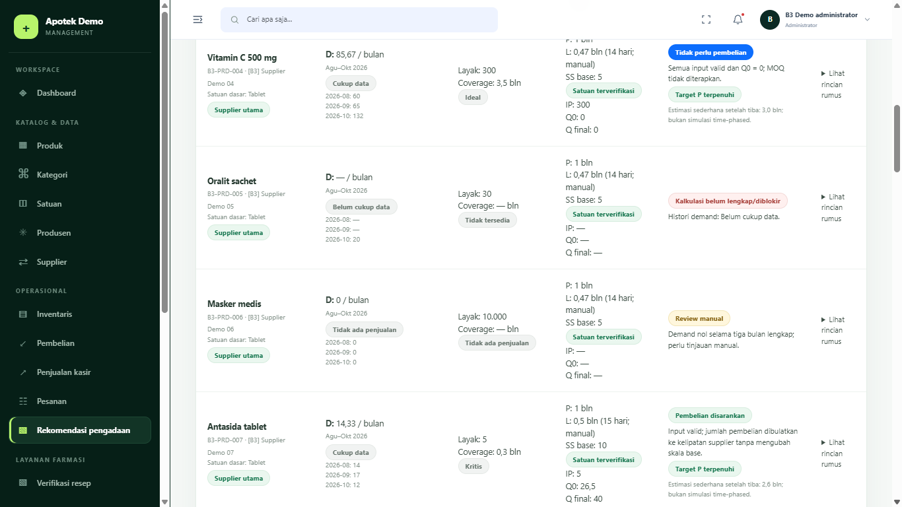
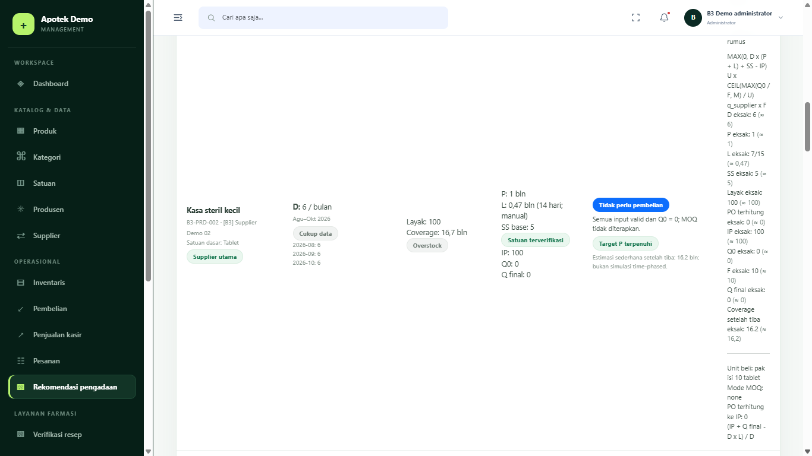
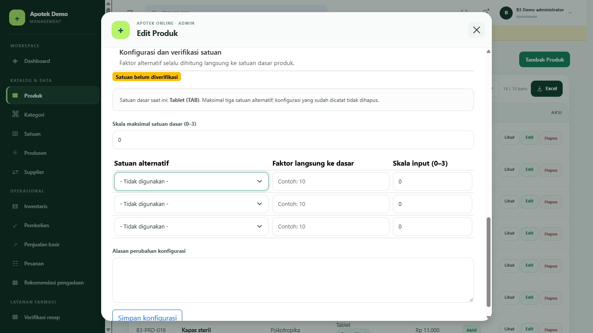

# Apotek Online

Apotek Online adalah aplikasi e-pharmacy berbasis CodeIgniter 3 dan MySQL/MariaDB untuk pengelolaan operasional apotek: katalog produk, satuan, batch/FEFO, pembelian, penjualan kasir, checkout pelanggan, pembayaran, pengiriman, inventaris, dan pelaporan.

## Sorotan Teknis

- CodeIgniter 3, PHP, MySQL/MariaDB
- Dashboard administratif modern dengan navigasi berkelompok
- Penjualan dashboard hanya menghitung pesanan lunas non-batal berdasarkan pembayaran lunas pertama.
- Satuan produk dan konversi base unit
- Verifikasi satuan satu kali per produk dengan audit
- Forecast Moving Average 3 bulan (bukan AI/ML) dan coverage stok
- Rekomendasi procurement baca-saja untuk environment demo
- Gerbang fitur berbasis environment dan marker database demo
- Seeder demo deterministik dan pemeriksaan invarian
- Migrasi additive dengan runner/ledger dan checksum
- Smoke karakterisasi POS, checkout, penerimaan PO, dan opname

## Lingkungan Demo

Implementasi demo menggunakan data sintetis, database terpisah, dan marker lingkungan. WAPE hanya dihitung pada riwayat sintetis. Konfigurasi rahasia lokal sengaja diabaikan Git. Repository publik tidak menyediakan akun demo atau kredensial.

## Tangkapan Layar

Semua gambar berikut berasal dari environment demo dan data sintetis.

## Jalankan Pengembangan

1. Siapkan PHP 7.4+, MySQL/MariaDB, dan web server lokal.
2. Salin berkas `*.example.php` ke nama konfigurasi lokal yang sesuai; jangan commit salinan lokal atau kredensial.
3. Jalankan migration dan fixture hanya pada database terpisah yang disetujui.
4. Gunakan environment tidak-produksi untuk fitur demo.

## Struktur Utama

- `application/controllers/`
- `application/libraries/`
- `application/models/`
- `application/views/`
- `application/migrations/`
- `tools/`
- `tests/`
- `docs/`

## Batas Publikasi

Repository ini adalah snapshot kode portofolio. Konfigurasi rahasia, upload, dump database, log, vendor, file backup, dan data operasional tidak boleh dipublikasikan. Pengujian smoke, integrasi transaksi, dan deployment produksi memerlukan persetujuan serta lingkungan terpisah.

## Reproducibility dan Batasan

Source, dokumentasi, migrasi, dan tes dapat ditinjau dari repository ini. Setelah dependensi pengembangan tersedia, tes unit yang tidak memerlukan database dapat dijalankan secara lokal. Tes integrasi, karakterisasi HTTP, dan alur demo memerlukan database scratch/demo terpisah, konfigurasi lokal yang tidak disertakan, serta fixture sintetis. Baseline operasional dan akun demo tidak disertakan, jadi hasil database-backed tidak dapat direproduksi hanya dengan clone repository. Fixture demo bersifat deterministik; akurasi forecast belum divalidasi pada data nyata dan WAPE hanya dihitung pada data sintetis. Batasan dan roadmap dirinci di [dokumen desain](../design/).

## Lisensi Pihak Ketiga

Direktori `system/` memakai CodeIgniter 3 MIT License (`license.txt`).
